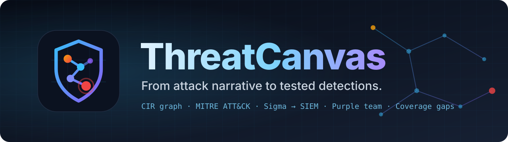
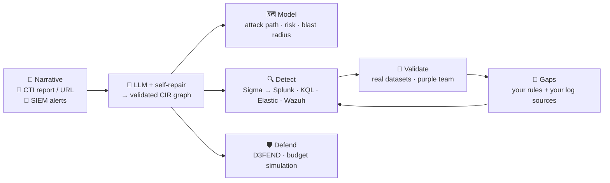
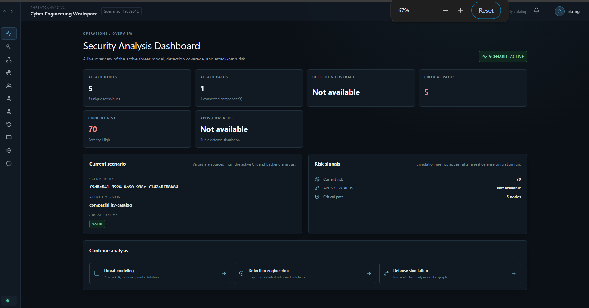
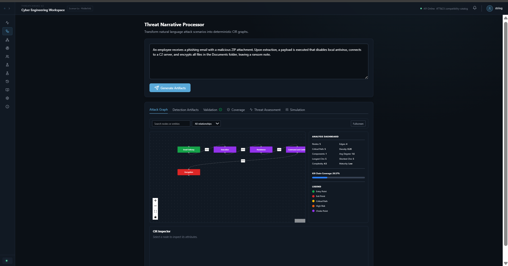
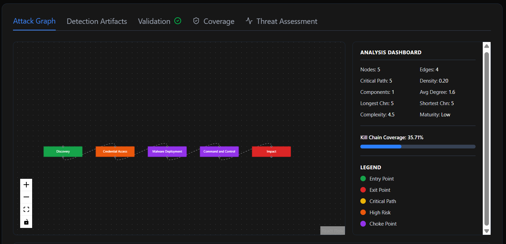
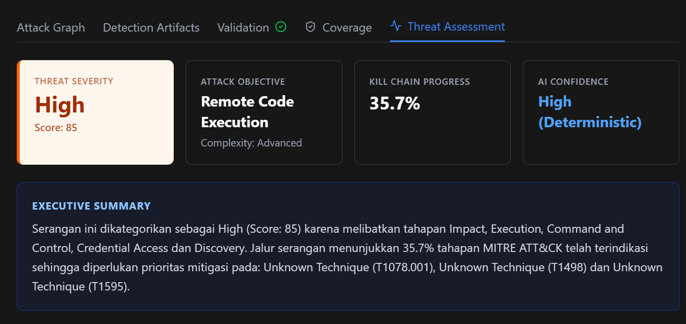
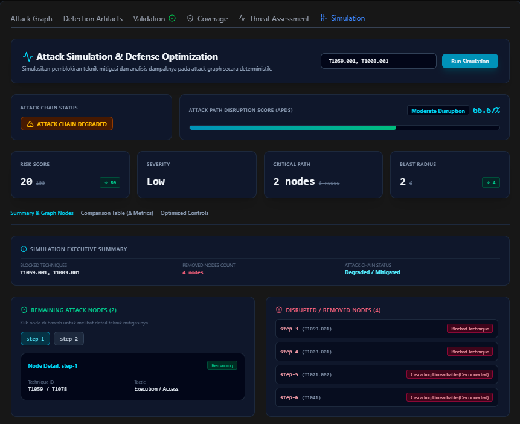
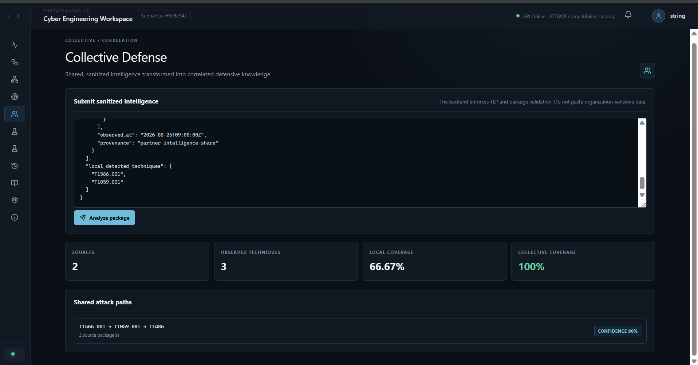
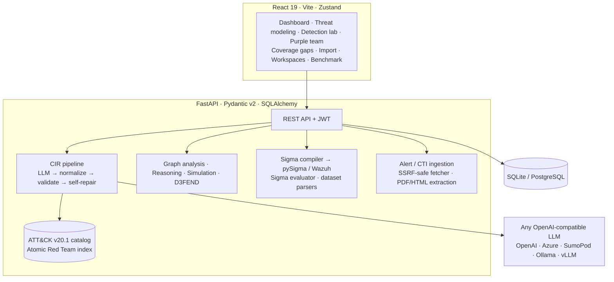
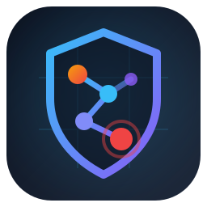

<div align="center">



<br/>

[](backend/requirements.txt)
[](backend)
[](frontend)
[](https://attack.mitre.org/)
[](https://github.com/SigmaHQ/pySigma)
[](#-testing)
[](LICENSE)

**Describe an attack in plain language, or drop in a CTI report or your SIEM alerts.<br/>ThreatCanvas turns it into an ATT&CK attack graph, detection rules for your SIEM, and proof of whether those rules actually fire.**

[Features](#-what-it-does) · [Screenshots](#-screenshots) · [Quick start](#-quick-start) · [What's new](#-whats-new) · [Configuration](#-configuration) · [API](#-api-reference)

</div>

---

## 💡 Why ThreatCanvas?

Most threat-modeling tools stop at a diagram, and most detection tools assume you already know what to detect. ThreatCanvas covers the whole loop. Every step works on one structured, validated attack graph (the **CIR**):



- **Grounded in MITRE ATT&CK v20.1.** All 867 Enterprise techniques ship with the repo, with official tactics, data components and log sources. Revoked IDs such as `T1562.001` that LLMs still produce are mapped automatically to their replacements.
- **Detections you can measure.** Rules are built from evidence fields, converted with the official pySigma backends, and tested against OTRF / Atomic Red Team recordings before you deploy them.
- **Honest coverage.** Gap analysis uses the rules you already run and the logs you actually collect, not a theoretical ATT&CK heatmap.
- **Bring your own model.** Works with OpenAI, Azure, SumoPod or a **local Ollama**, and a built-in benchmark compares models on the same 12 attack narratives.

---

## ✨ What it does

<table>
<tr>
<td width="50%" valign="top">

### 📥 Ingest
- **Narrative → CIR** with an LLM, then normalized and validated against ATT&CK. Failed checks are sent back to the model to fix (**self-repair**).
- **SIEM / EDR alerts → CIR**: Wazuh, Elastic Security, Sentinel / Defender, Splunk ES. Alerts with technique IDs are converted deterministically, without an LLM.
- **CTI report → CIR** from a URL, PDF, HTML or pasted text, fetched with SSRF protection.
- **STIX 2.1** import / export, plus TAXII / MISP / OpenCTI-style payloads.

</td>
<td width="50%" valign="top">

### 🗺️ Model
- Interactive **attack graph** and **knowledge graph** (evidence, provenance).
- Critical path, blast radius, most-likely path, asset risk, trust zones.
- **Threat reasoning** risk score and **attack time machine** replay.
- **AI Scenario Copilot** chat that knows the active scenario.
- **Executive report** (Markdown) and **ATT&CK Navigator** layers.

</td>
</tr>
<tr>
<td valign="top">

### 🔍 Detect
- Sigma rules generated from **evidence fields**: process, command line, registry, file, network, hash.
- Official **pySigma** conversions to **Splunk SPL**, **Defender XDR / Sentinel KQL** and **Elastic Lucene/ECS**, plus a **Wazuh XML** converter.
- Built-in validation: syntax, schema, telemetry, ATT&CK mapping and sample events.

</td>
<td valign="top">

### 🧪 Validate
- **Detection lab**: upload OTRF datasets (`.zip` / `.tar.gz` / JSONL), Atomic Red Team `.evtx` or Winlogbeat NDJSON, and measure recall, false positives and precision with sample matches.
- **Purple team loop**: export an **Invoke-AtomicRedTeam** script or a **Caldera** bundle, run it in your lab, import the telemetry and execution log, and see each technique marked *Detected* / *Missed* / *No rule* / *Not executed*.

</td>
</tr>
<tr>
<td valign="top">

### 🎯 Gaps & defense
- **Real coverage gaps** in the spirit of DeTT&CT: import your Sigma repo or a SIEM CSV, plus your data sources (checklist or **DeTT&CT YAML**). Each technique is *Covered*, *Rule without data*, *Data without rule* or *Blind*, with the missing log sources ranked.
- **D3FEND Copilot** countermeasures and **APDS / RW-APDS** defense simulation with budget optimization.
- Collective defense across shared CTI packages.

</td>
<td valign="top">

### 👥 Platform
- JWT auth; **scenarios private per user** by default.
- **Team workspaces** with owner / editor / viewer roles.
- **Model-agnostic LLM profiles** (incl. local Ollama) with an in-app model picker.
- **Model benchmark**: 12 narratives with ATT&CK v20 ground truth, scored on F1, step ordering, repairs and latency.
- Research metrics and per-operation telemetry.

</td>
</tr>
</table>

---

## 📸 Screenshots

<table>
<tr>
<td><p align="center"><b>Security dashboard</b></p></td>
<td><p align="center"><b>Narrative → CIR threat modeling</b></p></td>
</tr>
<tr>
<td><p align="center"><b>Attack graph & critical path</b></p></td>
<td><p align="center"><b>Executive threat assessment</b></p></td>
</tr>
<tr>
<td><p align="center"><b>Defense simulation (APDS / RW-APDS)</b></p></td>
<td><p align="center"><b>Collective defense</b></p></td>
</tr>
</table>

---

## 🚀 Quick start

**Requirements:** Python 3.13, Node.js 20.19+ (or 22.12+), and an OpenAI-compatible LLM endpoint (cloud API key or a local [Ollama](https://ollama.com)).

### 1. Backend

```bash
cd backend
python -m venv .venv
source .venv/bin/activate          # Windows: .venv\Scripts\Activate.ps1
pip install -r requirements.txt
cp .env.example .env               # then edit it (see below)
uvicorn app.main:app --reload --port 8000
```

> [!IMPORTANT]
> Set a random `SECRET_KEY` of at least 32 characters in `.env`. Outside test mode the backend refuses to start with a short or default key.
> `python -c "import secrets; print(secrets.token_urlsafe(48))"`

### 2. Frontend

```bash
cd frontend
npm install
npm run dev                        # http://localhost:5173
```

### 3. First user

Register in the UI, or from the shell:

```bash
curl -X POST http://localhost:8000/api/v1/auth/register \
  -H "Content-Type: application/json" \
  -d '{"username":"analyst","email":"analyst@example.com","full_name":"Security Analyst","password":"a-strong-password"}'
```

Then set `ALLOW_REGISTRATION=false` once your team's accounts exist.

### 🐳 Docker

```bash
docker build -t threatcanvas-backend backend/
docker run -p 8000:8000 --env-file backend/.env threatcanvas-backend
```

The build downloads the full ATT&CK bundle (`--build-arg FETCH_ATTACK_DATA=false` skips it and uses the bundled catalog). The image runs as a non-root user, and `.env` and local databases are never copied into it.

### 🦙 Fully local with Ollama

```env
LLM_PROFILES=[{"name":"llama3.1-local","base_url":"http://localhost:11434/v1","model":"llama3.1:8b","mode":"json"}]
```

---

## 🆕 What's new

<details open>
<summary><b>November 2026: hardening + seven new capabilities</b></summary>

<br/>

**New capabilities**

| | Feature | Highlights |
|---|---|---|
| 🔁 | **LLM self-repair** | Invalid CIRs go back to the model with their validation errors (`LLM_REPAIR_ATTEMPTS`); a full repair log is shown in the UI |
| 🧪 | **Detection lab** | pySigma → Splunk / KQL / Elastic, own Wazuh converter, measurement on OTRF & Atomic Red Team datasets |
| 🟣 | **Purple team loop** | Atomic Red Team plan (1,932 tests bundled), Invoke-AtomicRedTeam script, Caldera bundle, result import |
| 📥 | **Reverse ingestion** | SIEM alerts and CTI reports (URL / PDF) → CIR |
| 🎯 | **Real gap analysis** | Your Sigma repo / SIEM CSV + DeTT&CT data sources → covered / blind / quick wins |
| 👥 | **Workspaces** | Share scenarios with owner / editor / viewer roles |
| 🤖 | **Model-agnostic LLM** | Named profiles for any OpenAI-compatible API, JSON mode for local models, model picker |
| 📏 | **Model benchmark** | 12 narratives with ATT&CK v20 ground truth, side-by-side model comparison, CLI runner |

**Fixes & hardening**

- **Security:** scenarios are private per owner (fixes an IDOR where any user could read or delete others' scenarios). Chat rejects injected `system` messages. URL fetching is SSRF-safe: public IPs only, the validated IP is used for the connection (no DNS rebinding), and every redirect is re-checked. Sigma matching is ReDoS-safe (regex with timeouts). Uploads are zip-bomb safe and request bodies are capped. JWT moved from python-jose to **PyJWT** with a pinned algorithm. All Dependabot alerts are resolved.
- **ATT&CK:** a full v20.1 catalog is bundled (previously only ~46 techniques worked on a fresh clone). Tactic mappings are now correct, including the v18+ tactics *Stealth* and *Defense Impairment*. Data components and log sources are restored from detection strategies. Revoked IDs are remapped automatically.
- **Broken features repaired:** Navigator export, executive report, D3FEND Copilot and Copilot chat (all returned HTTP 500). Detection validation, which failed for every non-Execution technique. KQL / SPL output, which was syntactically invalid.
- **Ops:** the Docker image is Python 3.13 and non-root, with ATT&CK data fetched at build time. Startup migrations upgrade existing databases. Scenario history loads the stored graph instead of re-running the LLM.

</details>

---

## 🏗️ Architecture



<details>
<summary><b>Project structure</b></summary>

```text
backend/
  app/
    api/endpoints/     REST routes (parse, detection, purple, ingest, coverage-gap, workspaces, ...)
    services/          CIR pipeline, LLM client, ATT&CK knowledge, Sigma compiler/evaluator,
                       pySigma conversion, purple team, alert/CTI ingestion, gap analysis, benchmark
    models/            SQLAlchemy models        core/   config, security, migrations, limits
    data/              attack_catalog.json · atomic_index.json · benchmark/cases.json
  scripts/             fetch_attack_data · build_attack_catalog · build_atomic_index · run_benchmark
  tests/               227 tests
frontend/src/
  pages/               one page per feature      store/   Zustand stores      api/   typed client
benchmark/             original offline CIR evaluator
docs/                  methodology, screenshots, brand assets
```
</details>

---

## ⚙️ Configuration

Set in `backend/.env` (see `.env.example`).

| Variable | Purpose | Default |
|---|---|---|
| `SECRET_KEY` | JWT signing secret (**required**, strong) | — |
| `DATABASE_URL` | SQLAlchemy URL (SQLite or PostgreSQL) | `sqlite:///./threatcanvas.db` |
| `ALLOW_REGISTRATION` | Allow `/auth/register` | `true` |
| `OPENAI_API_KEY` / `OPENAI_API_BASE` | Default LLM endpoint | — / `https://ai.sumopod.com/v1` |
| `LLM_MODEL` / `LLM_MODE` | Default model; `tools` (function calling) or `json` | `gpt-4o` / `tools` |
| `LLM_PROFILES` | JSON list of named LLM profiles (see below) | *single default profile* |
| `LLM_DEFAULT_PROFILE` | Profile used when none is selected | first profile |
| `LLM_TIMEOUT_SECONDS` | Per-call LLM timeout | `90` |
| `LLM_REPAIR_ATTEMPTS` | Self-repair rounds before `/parse` gives up (0 disables) | `2` |
| `ATTACK_STIX_PATH` | Use a specific ATT&CK STIX bundle | bundled catalog |
| `CTI_ALLOW_PRIVATE_NETWORKS` | Let CTI fetching reach RFC1918 / ULA addresses | `false` |
| `LEGACY_SCENARIO_OWNER` | Username that adopts scenarios created before ownership existed | *auto if one user* |

<details>
<summary><b>🤖 LLM profiles: several models, cloud and local</b></summary>

<br/>

```env
LLM_PROFILES=[
  {"name":"gpt-4o","base_url":"https://api.openai.com/v1","api_key_env":"OPENAI_API_KEY","model":"gpt-4o","mode":"tools"},
  {"name":"llama3.1-local","base_url":"http://localhost:11434/v1","model":"llama3.1:8b","mode":"json"}
]
```

- `api_key_env` is the **name** of an environment variable, so keys never sit in the JSON.
- `mode: "json"` asks for a JSON object instead of a tool call, for models with weak function calling.
- Users pick the model in the UI. `GET /api/v1/llm/profiles` exposes names and modes only, never URLs or keys.
- A malformed `LLM_PROFILES` stops the backend at startup instead of failing later.
</details>

---

## 🔬 Feature deep dives

<details>
<summary><b>🧪 Detection lab: how measurement works</b></summary>

<br/>

1. Sigma rules are generated from each CIR step's evidence (structured fields first, conservative text heuristics otherwise).
2. They are converted with the official pySigma backends (Splunk + Sysmon/Windows pipelines, Kusto + Microsoft XDR pipeline, Elasticsearch + ECS) or ThreatCanvas' Wazuh converter.
3. ThreatCanvas evaluates Sigma itself: modifiers, wildcards, escaping, keywords and the full condition grammar, with logsource filtering that includes Windows 4688 aliases. This is needed because pySigma cannot execute rules.
4. Datasets are labelled *malicious* (attack recording) or *benign* (baseline). The report gives **dataset-level recall**, **benign alerts** (false positives) and an **alert-precision upper bound** (attack recordings also contain normal activity), plus sample matching events.

Limits: 50 MB uploads (250 MB uncompressed, 50k events), at most 200k events per evaluation, and a 30 s budget. Archives are processed in memory and nothing is extracted to disk.
</details>

<details>
<summary><b>🟣 Purple team loop: emulate, then verify</b></summary>

<br/>

1. **Plan:** each technique is mapped to [Atomic Red Team](https://github.com/redcanaryco/atomic-red-team) tests per platform, falling back to the parent technique.
2. **Export:** a PowerShell script for Invoke-AtomicRedTeam (writes an execution log), or a **Caldera** bundle. Caldera's atomic plugin derives ability IDs from a hash of each test, so the bundle ships its own abilities that call `Invoke-AtomicTest`, plus an adversary profile.
3. **Import:** the telemetry captured during the run, plus the Invoke-AtomicTest CSV or Caldera report. Each technique is marked *Detected* / *Missed* / *No rule* / *Not executed* / *Unverified*.

> [!WARNING]
> ThreatCanvas never executes anything itself. Run exported plans only in an isolated lab you are authorized to test.
</details>

<details>
<summary><b>📥 Reverse ingestion: alerts and CTI to an attack graph</b></summary>

<br/>

- **Alerts:** technique IDs are read from Wazuh `rule.mitre.id`, Elastic `kibana.alert.rule.threat`, ECS `threat.technique`, Sentinel / Defender `Techniques`, Splunk ES annotations or Sigma-style tags. Alerts are ordered by time and become one step per technique and host. Command lines, images, IPs, domains, hashes, files and registry keys become evidence. Alerts without IDs can optionally be reconstructed by the LLM.
- **CTI:** PDF (pypdf), HTML (main-content extraction) or text is passed to the LLM with CTI-specific instructions, with self-repair.
- **SSRF protection:** http(s) only on standard ports. Every resolved address must be public: loopback, link-local / cloud metadata, private, CGNAT, multicast and IPv4-mapped / 6to4 / Teredo forms are refused. The connection uses the validated IP while TLS still verifies the hostname. Redirects are re-validated, with size and time caps.
</details>

<details>
<summary><b>🎯 Coverage gaps: DeTT&CT style</b></summary>

<br/>

- **Rules:** Sigma files or a `.zip` of your rules repo (ATT&CK tags), or a CSV with `technique,title` exported from any SIEM. Tested with the full SigmaHQ Windows ruleset (2,180 rules in about 4.5 s).
- **Data sources:** pick ATT&CK data components or import a DeTT&CT data source administration YAML (v1.0 / v1.1).
- **Result per technique:** *Covered*, *Rule without data*, *Data without rule* (quick win) or *Blind*, plus the missing data components ranked by how many techniques they would unblock. Exportable as an ATT&CK Navigator layer.
</details>

<details>
<summary><b>📏 Model benchmark</b></summary>

<br/>

12 narratives with ATT&CK v20 ground truth: ransomware, PowerShell credential theft, admin-share lateral movement, web shell exfiltration, Kerberoasting, cloud account takeover, supply-chain DLL side-loading, insider USB theft, Linux cryptominer, business email compromise, living-off-the-land ransomware and a macOS infostealer.

Each model is scored on valid-CIR rate, exact and parent-level precision / recall / F1, step ordering, self-repair attempts and latency.

```bash
cd backend
python scripts/run_benchmark.py -p gpt-4o -p llama3.1-local -o results.json
```
</details>

---

## 🔐 Security

- **Auth:** JWT (PyJWT, pinned HMAC algorithm, required `exp` / `sub`). Every route except register / login / health needs a token. Registration can be switched off.
- **Data isolation:** scenarios, datasets, rule inventories, purple-team runs and benchmark runs are scoped to their owner. Shared scenarios are visible only to workspace members. Other users' resources return 404.
- **Input safety:** SSRF-safe fetching, ReDoS-safe rule matching, zip-bomb-safe archive parsing, 60 MB request cap, bounded uploads and evaluations, and no client-supplied system prompts.
- **Secrets:** API keys come only from the environment. Docker images exclude `.env` and databases and run as non-root.

Found a vulnerability? Please open a private security advisory on GitHub instead of a public issue.

---

## 📡 API reference

Interactive docs are available at **`http://localhost:8000/docs`**. All routes except auth and health require `Authorization: Bearer <token>`.

<details>
<summary><b>Show the main endpoints</b></summary>

<br/>

| Area | Method & path | Description |
|---|---|---|
| Auth | `POST /api/v1/auth/register` · `POST /api/v1/auth/login` | Accounts and JWT |
| Scenarios | `POST /api/v1/parse` | Narrative → validated CIR (self-repair; optional `model_profile`) |
| | `GET /api/v1/scenarios[?workspace=]` · `GET/DELETE /api/v1/scenarios/{id}` | Own + shared scenarios |
| | `PUT /api/v1/scenarios/{id}/workspace` | Share / unshare |
| Analysis | `GET /api/v1/graph-analysis/{id}` · `/reasoning/{id}` · `/coverage/{id}` · `/timeline/{id}` | Graph metrics, risk, coverage, replay |
| | `POST /api/v1/chat/{id}` · `GET /api/v1/d3fend/{id}` | Copilot and countermeasures |
| | `POST /api/v1/{id}` | APDS / RW-APDS simulation and budget optimization |
| Export | `GET /api/v1/export/navigator/{id}` · `/export/report/markdown/{id}` · `/api/stix/export/{id}` | Navigator layer, report, STIX |
| Detection | `GET /api/v1/compile/{sigma\|kql\|spl}/{id}` · `POST /api/v1/validate/{type}/{id}` | Generate and validate |
| | `GET /api/v1/detection/convert/{target}/{id}` · `POST /api/v1/detection/convert/{target}` | pySigma / Wazuh conversion |
| | `GET/POST/DELETE /api/v1/detection/datasets` · `POST /api/v1/detection/evaluate` | Datasets and measurement |
| Purple team | `GET /api/v1/purple/plan/{id}` · `POST /api/v1/purple/export/{id}` · `POST/GET /api/v1/purple/runs` | Plan, export, results |
| Ingest | `POST /api/v1/ingest/alerts` · `POST /api/v1/ingest/cti` | Alerts / CTI → CIR |
| Gaps | `POST/GET/DELETE /api/v1/coverage-gap/rules` · `GET/PUT /api/v1/coverage-gap/data-sources` · `POST …/data-sources/dettect` | Inventory and data sources |
| | `GET /api/v1/coverage-gap/{id}` · `GET /api/v1/coverage-gap/{id}/navigator` | Gap analysis |
| Team | `GET/POST /api/v1/workspaces` · `…/{id}/members` | Workspaces and roles |
| LLM | `GET /api/v1/llm/profiles` | Available models |
| Benchmark | `GET /api/v1/benchmark/cases` · `POST/GET /api/v1/benchmark/runs` | Model comparison |
| CTI | `POST /api/v1/cti/fetch` · `POST /api/stix/import` | TAXII / MISP / OpenCTI / STIX |
</details>

---

## 🧪 Testing

```bash
# backend: 227 tests
cd backend
ENVIRONMENT=test pytest            # PowerShell: $env:ENVIRONMENT="test"; pytest

# frontend: lint, 15 component/store tests, production build
cd frontend
npm run lint && npm run test && npm run build
```

The suite covers per-user isolation on every scenario route, SSRF (including redirects to cloud metadata and DNS pinning), ReDoS, zip bombs, migrations from older databases, every LLM failure path with self-repair, and real-format parsing for OTRF, EVTX, Wazuh, Elastic, Sentinel and Splunk.

---

## 🙏 Data sources & credits

- [MITRE ATT&CK®](https://attack.mitre.org/) and [D3FEND™](https://d3fend.mitre.org/). ATT&CK data © The MITRE Corporation, used under the [ATT&CK terms of use](https://attack.mitre.org/resources/legal-and-branding/terms-of-use/).
- [Atomic Red Team](https://github.com/redcanaryco/atomic-red-team) by Red Canary (MIT). The bundled index's license is in `backend/app/data/ATOMIC_RED_TEAM_LICENSE.txt`.
- [Sigma](https://github.com/SigmaHQ/sigma) and [pySigma](https://github.com/SigmaHQ/pySigma) with their backends, plus [OTRF Security-Datasets](https://github.com/OTRF/Security-Datasets), [DeTT&CT](https://github.com/rabobank-cdc/DeTTECT) and [MITRE Caldera](https://github.com/mitre/caldera).

---

## 🤝 Contributing

Issues and pull requests are welcome. Please include tests: `pytest` for the backend, and `npm run lint && npm run test` for the frontend. Keep changes scoped, one feature per PR.

## 📜 License

[MIT](LICENSE)

<div align="center">
<br/>

<br/>
<sub>Built for defenders who want to know, not guess.</sub>
</div>
