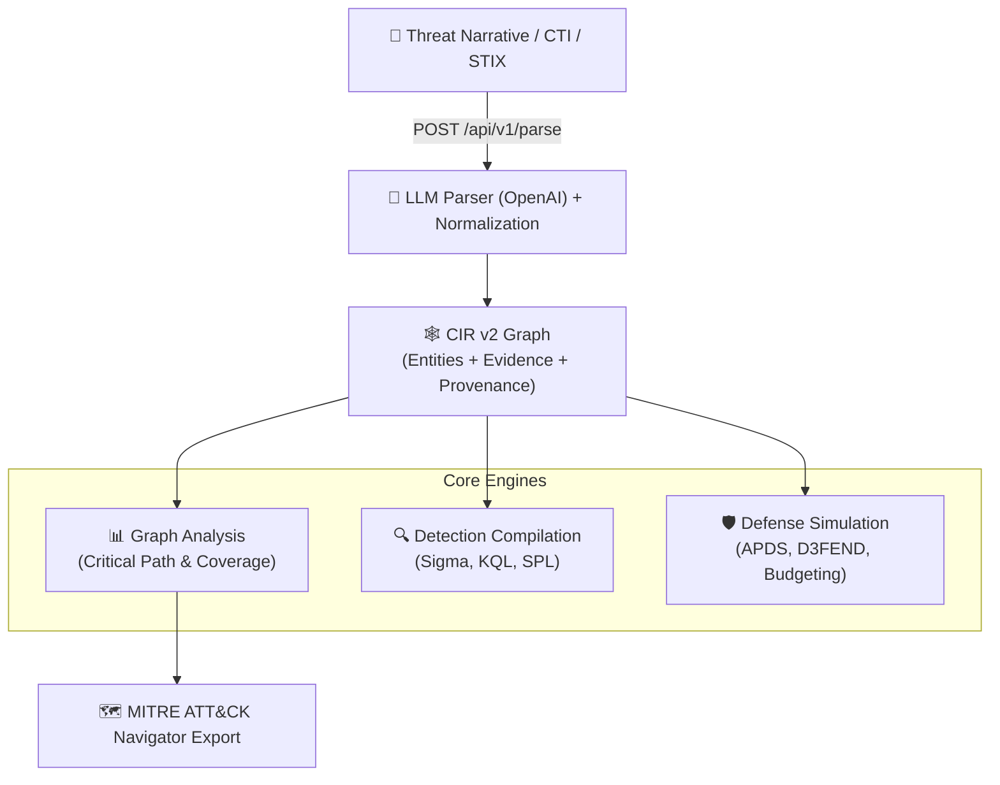

# 🛡️ ThreatCanvas

**ThreatCanvas** is an AI-assisted cyber engineering workspace for turning natural-language attack narratives and CTI packages into structured CIR graphs, ATT&CK-aware analysis, detection artifacts, collective-defense insights, and measurable defense simulations.

Built with a clear separation of concerns:
- **Threat Modeling & Attack Graph**: Maps the ordered attack path for the active scenario.
- **Knowledge Graph**: Explores CIR entities, provenance, evidence, and typed relationships.
- **Threat Intelligence**: Imports STIX and normalizes TAXII/MISP/OpenCTI-style payloads.
- **Collective Defense**: Correlates sanitized packages into shared techniques, coverage gaps, and a collective threat graph.
- **Simulation**: Measures how blocked techniques disrupt attack paths using APDS, RW-APDS, D3FEND-aligned recommendations, and budget optimization.

---

## 🌟 Key Features

- **🧠 AI-Powered Narrative Parsing**: Convert raw natural-language scenarios into structured CIR v2 graphs automatically.
- **💬 AI Scenario Copilot (NEW)**: Interactive chat interface to ask questions about the generated threat scenario, request mitigation strategies, and explore the graph conceptually.
- **🗺️ Interactive Threat Topologies**: Attack graph visualization with search, relationship filtering, critical path, high-risk nodes, blast radius, and graph metrics.
- **🛡️ D3FEND Remediation Copilot (NEW)**: Automatically maps extracted ATT&CK techniques to D3FEND countermeasures, providing a tailored active defense plan with rationales and confidence scores.
- **📄 Executive Report Generator (NEW)**: Instantly generate a comprehensive markdown report covering the threat narrative, graph summary, and critical path risk assessment.
- **🛡️ ATT&CK Navigator Export (NEW)**: Export your threat scenarios directly into a JSON layer compatible with the official MITRE ATT&CK Navigator.
- **🔍 Detection Engineering (Sigma/KQL/SPL)**: Generate and validate detection artifacts (syntax, schema, telemetry mapping, precision, recall, and F1).
- **💸 Budget-Aware Defense Simulation**: Run APDS/RW-APDS simulations to optimize defense controls based on a constrained security budget.
- **📊 Executive Assessment**: Critical path explainer, missing detection details, asset-aware risk signals, trust-zone grouping, and most-likely path probability.
- **⏱️ Attack Time Machine**: Replay ordered scenario steps visually.
- **🌐 CTI & STIX 2.1**: Import/Export STIX bundles, generic JSON connector for TAXII/MISP/OpenCTI.
- **🔒 Enterprise Ready**: JWT authentication, SSRF protection on CTI connectors, and controlled registration.

---

## 🧪 Detection Lab

The **Detection Engineering** page turns scenario evidence into Sigma rules and:

- converts them with the official **pySigma** backends to **Splunk (SPL)**, **Microsoft Defender XDR / Sentinel (KQL)** and **Elastic (Lucene/ECS)**, plus **Wazuh** XML rules (ThreatCanvas converter for the windows eventchannel decoder);
- measures any Sigma rules against uploaded log datasets: [OTRF Security-Datasets](https://github.com/OTRF/Security-Datasets) (`.zip`/`.tar.gz`/JSON lines), Atomic Red Team / Windows **`.evtx`**, Winlogbeat NDJSON. Each dataset is labelled *malicious* (attack recording) or *benign* (baseline); the report shows dataset-level recall, benign alerts (false positives) and an alert-precision upper bound, with sample matching events.

Uploads are limited to 50 MB (250 MB uncompressed, 50k events) and parsed in memory; regex/wildcard matching runs with a timeout so user-supplied rules cannot stall the server.

---

## 🟣 Purple Team Loop

The **Purple Team** page closes the loop between a scenario and real telemetry:

1. **Plan**: every CIR technique is mapped to [Atomic Red Team](https://github.com/redcanaryco/atomic-red-team) tests (bundled index, MIT, see `backend/app/data/ATOMIC_RED_TEAM_LICENSE.txt`; parent-technique fallback for sub-techniques).
2. **Export**: an Invoke-AtomicRedTeam PowerShell script, or a **Caldera** bundle (abilities + adversary profile). Caldera's atomic plugin derives ability ids from a hash of each test, so the bundle ships its own abilities that call `Invoke-AtomicTest` on the agent.
3. **Import results**: pick the telemetry captured during the run (a Detection Lab dataset) and optionally the execution log (Invoke-AtomicTest CSV or Caldera operation report). Each technique is reported as *Detected*, *Missed*, *No rule*, *Not executed* or *Unverified*.

ThreatCanvas never executes attacks itself. Run exported plans only in an isolated lab you are authorized to test. Refresh the index with `python scripts/build_atomic_index.py <atomic-red-team checkout>`.

---

## 📥 Import Attack Data (reverse direction)

The **Import Attack Data** page builds a scenario from real data instead of a written narrative:

- **SIEM / EDR alerts**: Wazuh `alerts.json`, Elastic Security detection alerts, Microsoft Sentinel / Defender API exports, Splunk ES notables or generic JSON. Alerts carrying ATT&CK technique ids are converted **deterministically** (time-ordered, one step per technique and host, evidence from alert fields); alerts without technique ids can optionally be reconstructed by the LLM.
- **CTI reports**: a URL, a PDF/HTML file or pasted text is reduced to readable text and turned into a CIR by the LLM (with self-repair). URL fetching only reaches public addresses: the resolved IP is pinned for the connection (no DNS rebinding), every redirect is re-validated, and size and time are capped.

---

## 🎯 Coverage Gaps (real, not theoretical)

The **Coverage Gaps** page compares a scenario with your actual environment, in the spirit of [DeTT&CT](https://github.com/rabobank-cdc/DeTTECT):

- **Existing rules**: import Sigma rules (files or a `.zip` of your rules repo; ATT&CK tags are used) or a CSV (`technique,title`) exported from any SIEM.
- **Collected data sources**: tick the ATT&CK data components you receive, or import a DeTT&CT data source administration YAML.
- **Analysis**: each technique is *Covered*, *Rule without data*, *Data without rule* (quick win), or *Blind*, plus the missing data components that would unblock the most techniques and an ATT&CK Navigator layer. Technique → data component / log source mappings come from ATT&CK detection strategies and analytics (v18+) or data components (older releases).

---

## 🤖 LLM providers (model-agnostic)

Any OpenAI-compatible API works: OpenAI, Azure OpenAI, SumoPod, **Ollama**, vLLM, LM Studio. Without extra config a single profile is built from `OPENAI_API_BASE`, `OPENAI_API_KEY`, `LLM_MODEL` and `LLM_MODE`. To offer several models (users pick one in the UI), set `LLM_PROFILES`:

```env
LLM_PROFILES=[{"name":"gpt-4o","base_url":"https://api.openai.com/v1","api_key_env":"OPENAI_API_KEY","model":"gpt-4o","mode":"tools"},{"name":"llama3.1-local","base_url":"http://localhost:11434/v1","model":"llama3.1:8b","mode":"json"}]
```

`api_key_env` names an environment variable, so keys never appear in the JSON. `mode: "json"` uses JSON mode instead of function calling for models with unreliable tool support. A malformed `LLM_PROFILES` stops the backend at startup.

## 👥 Workspaces

Scenarios are private by default. Create a workspace (**Workspaces** page), add colleagues as *owner*, *editor* or *viewer*, and share scenarios into it from the **Scenarios** page. Viewers can analyze; editors can also share and delete; owners manage members. Deleting a workspace returns its scenarios to their creators. Datasets, rule inventories and purple-team runs stay personal.

## 📏 Model benchmark

The **Benchmark** page (or `python scripts/run_benchmark.py -p <profile> ...` in `backend/`) runs 12 bundled narratives (ransomware, web shell, Kerberoasting, cloud takeover, supply chain, insider, Linux cryptominer, BEC, living-off-the-land, macOS infostealer, ...) through the full pipeline for each selected model and reports valid-CIR rate, technique precision/recall/F1 (exact and parent-level), step ordering, self-repair attempts and latency. Ground truth uses current ATT&CK ids; revoked ids in model output (e.g. T1562.001 → T1685) are mapped to their replacements before scoring.

---

## 🏗️ Architecture



**Tech Stack**:
- **Frontend**: React 19 + TypeScript + Vite + TailwindCSS + Zustand
- **Backend**: FastAPI + Pydantic v2 + SQLAlchemy + SQLite/PostgreSQL

---

## 🚀 Quick Start

### 1. Backend Setup
```bash
cd backend
python -m venv .venv
# Activate environment
source .venv/bin/activate  # Linux/macOS
.venv\Scripts\Activate.ps1 # Windows

# Install dependencies
python -m pip install -r requirements.txt

# Configure environment
cp .env.example .env
```
> **Security Note**: You MUST set a secure `SECRET_KEY` in `.env`. The backend will refuse to start in production with an insecure default key.
> Generate one via: `python -c "import secrets; print(secrets.token_urlsafe(32))"`

Start the API:
```bash
uvicorn app.main:app --reload --port 8000
```

### 2. Frontend Setup
```bash
cd frontend
npm install
npm run dev
```
Access the dashboard at `http://localhost:5173`.

### 3. First User Creation
Registration is controlled via the `ALLOW_REGISTRATION` flag in the backend config. By default it is enabled for initial setup. Create your Lead Architect account:
```bash
curl -X POST http://localhost:8000/api/v1/auth/register \
  -H "Content-Type: application/json" \
  -d '{"username":"analyst","email":"analyst@threatcanvas.local","full_name":"Security Analyst","password":"a-strong-password"}'
```

---

### Docker
```bash
docker build -t threatcanvas-backend backend/
```
The build downloads the full MITRE ATT&CK Enterprise bundle (pass `--build-arg FETCH_ATTACK_DATA=false` to skip; the committed compact catalog is used instead). The container runs as a non-root user, and `.dockerignore` keeps `.env` and local databases out of the image.

---

## 🔧 Environment Variables

| Variable | Purpose | Default |
|---|---|---|
| `PROJECT_NAME` | Application name | `ThreatCanvas AI` |
| `ENVIRONMENT` | Runtime environment label | `development` |
| `OPENAI_API_KEY` | LLM provider API key | *empty* |
| `OPENAI_API_BASE` | OpenAI-compatible API base URL | `https://ai.sumopod.com/v1` |
| `DATABASE_URL` | SQLAlchemy database URL | `sqlite:///./threatcanvas.db` |
| `SECRET_KEY` | JWT signing secret | *must be replaced* |
| `ALLOW_REGISTRATION`| Toggle open registration for the `/register` endpoint | `true` |
| `ATTACK_STIX_PATH` | Optional local ATT&CK STIX bundle path | Auto-detects local JSON |
| `CTI_ALLOW_PRIVATE_NETWORKS` | Allow `/cti/fetch` to target RFC1918 private IPs | `false` |
| `LEGACY_SCENARIO_OWNER` | Username that adopts scenarios created before per-user ownership (empty = auto-adopt only when exactly one user exists) | *empty* |
| `LLM_REPAIR_ATTEMPTS` | Self-repair rounds: a CIR that fails schema/ATT&CK validation is sent back to the LLM with its errors this many times before `/parse` returns 400 (0 disables) | `2` |

---

## 📡 API Reference

All functional endpoints require `Authorization: Bearer <token>` (obtained from `/api/v1/auth/login`).

| Method | Endpoint | Description |
|---|---|---|
| `POST` | `/api/v1/auth/register` | Register a user (controlled via ALLOW_REGISTRATION) |
| `POST` | `/api/v1/parse` | Parse a narrative into CIR v2 |
| `GET` | `/api/v1/scenarios` | List saved scenarios |
| `GET` | `/api/v1/graph-analysis/{scenario_id}` | Graph metrics, critical path, asset risk |
| `GET` | `/api/v1/compile/{type}/{scenario_id}` | Compile `sigma`, `kql`, or `spl` rules |
| `POST` | `/api/v1/chat/{scenario_id}` | Ask questions to the AI Copilot about the scenario |
| `GET` | `/api/v1/d3fend/{scenario_id}` | View mapped D3FEND defensive countermeasures |
| `POST` | `/api/v1/{scenario_id}` | Run APDS/RW-APDS simulation & defense optimization |
| `GET` | `/api/v1/export/report/markdown/{scenario_id}`| Export an Executive Summary Report in Markdown |
| `GET` | `/api/v1/export/navigator/{scenario_id}`| Export scenario to MITRE ATT&CK Navigator JSON layer |
| `POST` | `/api/v1/cti/fetch` | Normalize STIX/TAXII/MISP/OpenCTI-style JSON payloads |

*(For full API documentation, visit `http://localhost:8000/docs` while the backend is running).*

---

## 🧪 Testing & Validation

**Backend**:
```bash
cd backend
$env:ENVIRONMENT="test"
pytest
```

**Frontend**:
```bash
cd frontend
npm run lint
npm run test
npm run build
```

**Benchmark**:
The repository includes a deterministic benchmark evaluator for validating CIR parsing precision and recall.
```bash
python -m benchmark.evaluation.report --cir-dir benchmark/results
```

---

## 📜 License

[MIT License](LICENSE)
